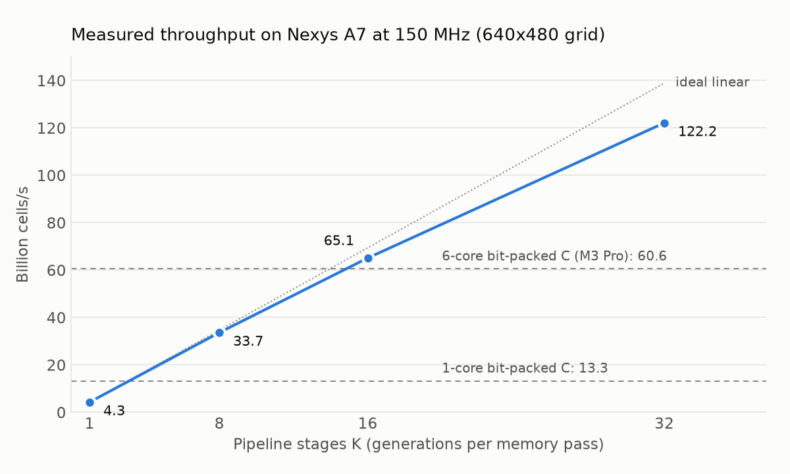

# Cellular_Automata
This is a cellular automaton accelerator written entirely in Verilog for the Artix-7 FPGA on the Nexys A7 board. A 32-lane streaming datapath updates 32 cells per clock cycle on a 640x480 grid at 150 MHz: line buffers rebuild a 3x3 sliding window each clock, and each cell's neighbor-count sum indexes an 18-bit birth/survival rule, so 16 different cellular automata are selectable at runtime from the board switches. A **temporal pipeline** chains 32 copies of that datapath, so every pass through memory computes 32 generations. The grid is shown live over VGA (no tearing) and a 64x48 window can be streamed over UART to make GIFs.

## Results



| Pipeline stages | Cycles per pass (7-seg, on hardware) | Throughput at 150 MHz | LUTs | WNS |
|---|---|---|---|---|
| 1 | 10,614 | 4.3 billion cells/s | 1,184 | +0.510 ns |
| 8 | 10,943 | 33.7 billion cells/s | 5,240 | +0.185 ns |
| 16 | 11,319 | 65.1 billion cells/s | 9,873 | +0.343 ns |
| **32** | **12,071** | **122.2 billion cells/s** | **19,085 (30%)** | **+0.329 ns** |

- **How it was measured:** an on-board counter times each pass and shows it on the 7-segment display. Every point matches the cycle-accurate simulation exactly.
- **Clock:** 150 MHz from an on-chip MMCM (the board oscillator is 100 MHz); timing met post-route at every point.
- **Scaling:** throughput and LUTs both grow almost linearly with the number of stages (about 590 LUTs per stage); the small gap from ideal is each stage's 47 cycles of pipeline fill per pass.
- **VGA output:** confirmed on a monitor with the earlier single-engine 100 MHz build; not yet re-checked with the pipeline.

**CPU comparison.** A bit-packed, multithreaded C implementation (64 cells per machine word, same runtime-selectable rule) reaches 13.3 billion cells/s on one core and 60.6 billion on six cores of an Apple M3 Pro. With 32 stages the FPGA is about **2x the 6-core CPU** (9x one core). Two caveats: the C version wraps the grid vertically while the pipeline uses dead top/bottom edges (the work per cell is the same), and the whole 640x480 grid fits in the CPU's cache, which favors the CPU.

## How the temporal pipeline works
A single engine reads one 32-cell word and writes one per clock, so it is limited by memory bandwidth, not logic: the first version used under 2% of the LUTs. The pipeline keeps the same memory traffic but streams the data through K engine stages in series, each computing one generation, so one pass computes K generations.

- **Edges:** rows wrap horizontally; the top and bottom edges are dead (always 0). Vertical wraparound would need the last row of each generation before its first row, which a streaming pipeline can't have without buffering a whole frame per stage.
- **Re-padding:** horizontal wraparound works by streaming each row as `last word, row, first word`. A stage produces the last word of a row last, so each stage buffers its output row in a small two-row ping-pong buffer and re-emits it padded for the next stage. The padding slots already exist in the stream, so this costs latency (47 cycles per stage), not throughput.
- **Timing:** the rule is latched per stage and passed down the chain, so rule bits never fan out to all 32 stages; each stage's result is registered before it is stored.

## Verification
Every testbench is self-checking against a reference model written independently of the RTL, and checks the design only through its outputs:

- `tb_ca_update_engine_wide.v`: single engine, 6 lane/latency configurations x 8 rules (including random rules) against a bit-level reference
- `tb_ca_pipeline_engine.v`: temporal pipeline, 8 configurations (1 to 32 stages, 1 to 32 lanes, both memory latencies) x 6 rules against a dead-edge reference that applies K generations per pass
- `tb_ca_video_core_wide.v`: the full core with both engines, checked from its output pins only (pixel positions derived from sync timing, every frame exactly one pass, UART decoded bit by bit)
- `tb_gen_cycle_display.v`: 7-segment readout decoded from the anode/segment pins
- `tb_nexys_a7_top_wide_perf.v`: the real board top at 640x480; the 7-segment display reads the expected cycles per pass

The tests were mutation-checked: deliberately broken RTL is caught (wrong latencies, off-by-one counters, a re-padder emitting one cycle early, the wrong ping-pong half, edge rows not zeroed, an unlatched rule, the wrong padding word). Run them all with Icarus Verilog:

```
bash run_tests.sh          # ~2 min (board-top test with 4 stages)
bash run_tests.sh full     # ~8 min (board-top test with all 32 stages)
```

## Layout
- `rtl/`: design sources (`nexys_a7_top_wide.v` is the board top; `STAGES` selects the number of pipeline stages, 0 for the original single engine)
- `constraints/`: Nexys A7 pin and clock constraints
- `tb/`: testbenches
- `tools/`: GIF maker, NumPy reference, scaling-plot script, reference GIFs

The original 1-lane design (one cell per clock, 517 LUTs, timing met at 100 MHz) came first; the figure below is its simulation.

## Next steps
- Neural cellular automata: a learned update rule (trained in PyTorch, quantized to int8) running on the FPGA's DSP blocks
- Push past 150 MHz (the display address path into the BRAMs is now the worst path)
- Collect the UART-streamed GIFs for every rule


|  |
| --- |
| Figure 1: Simulation run in Vivado for the testbench `tb_ca_video_core.v` (original 1-lane design)|
